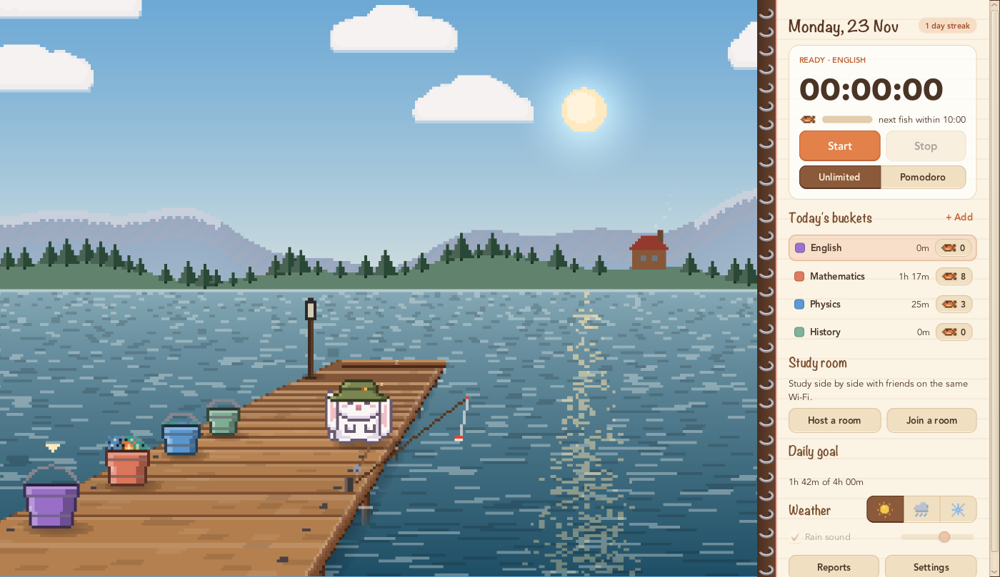
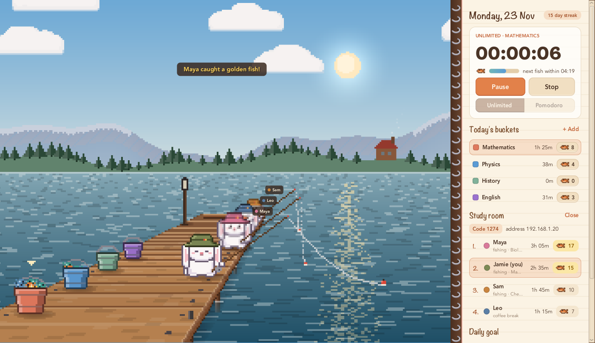
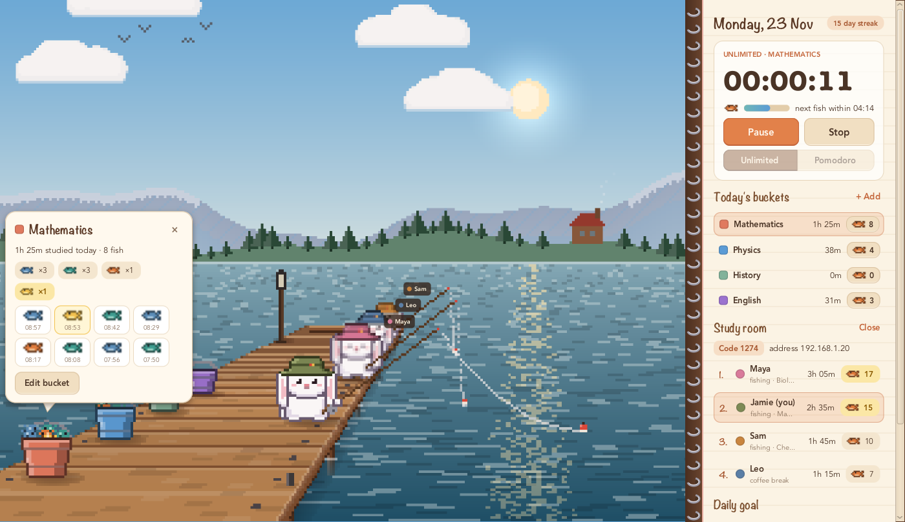
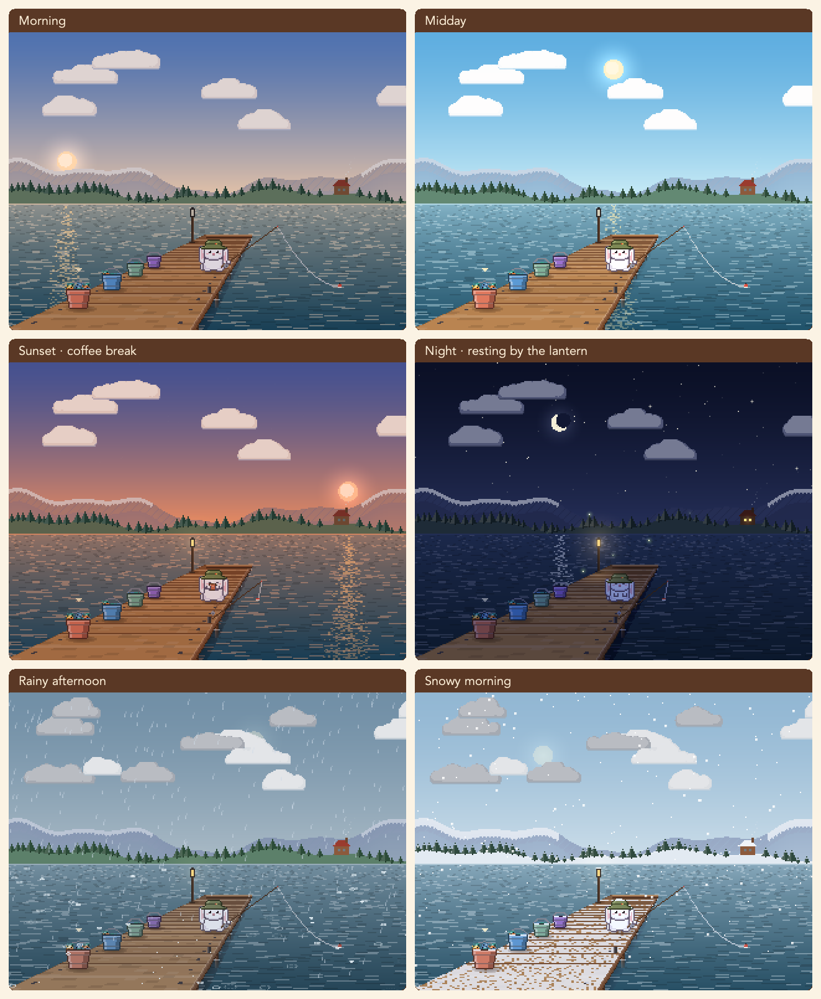
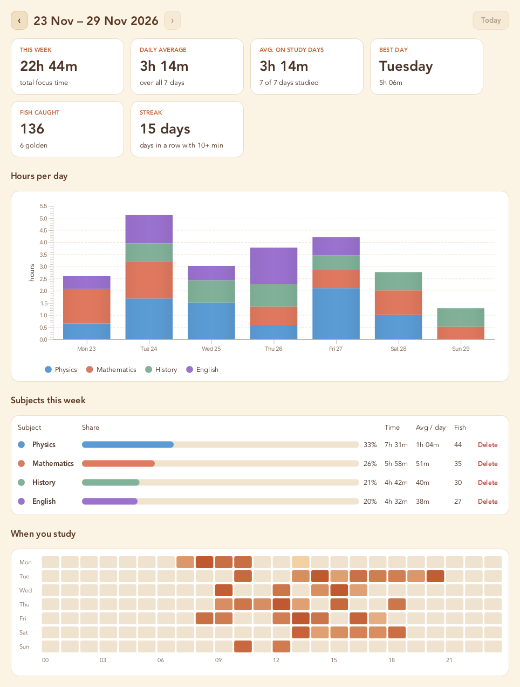

# Cozy Rabbit Study

A cozy pixel-art study timer. A white lop-eared rabbit in a khaki fisherman's hat sits on a wooden pier and
catches a fish for every stretch of time you study. Each subject has its own bucket, so at the end of the day
you can see how much you studied, and on what, in a playful way.



Built with Java 21 and JavaFX. All the artwork (pier, lake, rabbit, weather) is drawn in code and all sounds are
synthesized in code, so the project has no image or audio files to download.

## Features

**Studying**
- **Unlimited mode** is a stopwatch you can pause and resume. **Pomodoro mode** runs focus, short break and long
  break phases (lengths in Settings); the rabbit fishes while you focus and drinks coffee on breaks and pauses.
- **Buckets:** add a bucket (name and color) for each subject you study today. Up to 6 per day, and the pier
  starts empty every morning. Click a bucket to see every fish in it and when it was caught.
- **Fish:** study time is split into catch windows (10 minutes by default, 10 to 60 in Settings). Exactly one fish
  bites at a random moment inside each window. 60 uninterrupted minutes earn a golden fish, 120 a legendary koi.
- Daily goal, study streak, and the option to delete a subject with all its time and fish.

**Atmosphere**
- Sunny, rainy (with a synthesized rain sound) and snowy weather.
- The sky follows your clock: morning, day, sunset, and a night with stars, fireflies and a glowing lantern.
- Sound effects for casting, splashes, reeling, catches, buttons and the pomodoro bell.

**Reports**
- Daily: total time, goal progress, fish, per-subject breakdown and a timeline.
- Weekly: total, daily average, average per study day, best day, stacked hours per day and an hour-by-day heatmap.

**Study rooms** (on the same network)
- One person hosts a room and shares the 4-digit code; friends join with it (or with the host's address).
- Everybody sees a live ranking with today's study time, fish and what each person is doing. Up to three friends
  sit on the pier with you, each with their own hat color and name tag, and you see their fish jump out of the water.
- Only a nickname, hat color, current subject and study/fish numbers are shared, and only inside your network.

**Mini island**
- A small always-on-top timer at the top of the screen. Click it for pause/resume, the current bucket's fish,
  stop and a button that brings the app back. Drag it anywhere; turn it off in Settings.

## Screenshots

Everything below uses demo data and made-up friends.

### Studying together
Friends in a study room sit on the pier with you, each with their own hat color, and a note pops up when one of
them catches a fish. The journal ranks everybody by today's study time.



### Every fish, and when it was caught
Click a bucket to open a speech bubble with its fish and the time each one bit.



### Weather and time of day
The sky follows your clock, and you can pick sunny, rainy or snowy weather. The rabbit rests at night and has a
coffee on breaks.



### Weekly report
Hours per day by subject, the share and fish per subject, and a heatmap of when you study.



## Run it

You need a JDK 21 or newer. JavaFX and SQLite are downloaded by Maven automatically.

- **IntelliJ IDEA:** open this folder as a Maven project, pick the **Cozy Rabbit Study** run configuration and
  press Run (or run `src/main/java/com/cozyrabbit/Launcher.java`).
- **Terminal:** `mvn javafx:run`

## Build installable apps

Both scripts copy their result to your Desktop. Maven is used from your `PATH` (or from IntelliJ's bundled copy
on macOS).

- **macOS app:** `./scripts/build-app.sh` builds `Cozy Rabbit Study.app` with its own Java runtime, for the
  processor type of the Mac you build on. The app is not signed with an Apple developer certificate, so on the
  first launch right-click it and choose *Open*.
- **Linux package:** `./scripts/build-linux.sh` builds `cozy-rabbit-study-linux.zip` for x86_64 and ARM
  (aarch64) Linux. It needs `zip`. The recipient installs Java 21 or newer and runs `bash install.sh` once; see
  `packaging/linux/README-LINUX.txt`.
  - Ubuntu / Debian: `sudo apt install openjdk-21-jre`
  - Fedora 44 and newer: `sudo dnf install java-25-openjdk`

## Study rooms: ports and troubleshooting

Rooms use TCP port `47321` and UDP port `47322` on the local network. If you host from a computer with a
firewall, allow both ports once. Joining needs no setup.

Many school, university, hotel and café networks (eduroam, for example) don't let devices talk to each other.
If joining fails there, use a phone hotspot for everybody, or put everybody on a VPN app such as Tailscale and
type the host's VPN address in *Join a room*. The host's address is shown under *Study room* in the journal;
`127.0.0.1` always means "this computer" and never works for a friend. Joining with the 4-digit code only works
on networks that allow broadcast messages.

## Your data

Everything is stored locally in `~/.cozyrabbit/cozyrabbit.db` (SQLite). There are no accounts and no analytics.
Running sessions are saved every 15 seconds, sessions are split at midnight, and if the computer sleeps the timer
pauses itself instead of counting the gap.

## Developer helpers

These JVM options exist for testing and for making the screenshots above (they are ignored in normal use):

| Option | Effect |
|---|---|
| `-Dcozyrabbit.db=<file>` | Use another SQLite file instead of `~/.cozyrabbit/cozyrabbit.db` |
| `-Dcozyrabbit.snapshot=<dir>` | Save screenshots of the main window and the reports, then quit |
| `-Dcozyrabbit.snapshotDelay=<seconds>` | Wait this long before the first screenshot (default 4) |
| `-Dcozyrabbit.autostart=true` | Start the timer right away |
| `-Dcozyrabbit.autohost=true` | Open a study room right away |
| `-Dcozyrabbit.advertiseAddress=<ip>` | Show this address as the room's address instead of the detected one |

## Project layout

```
src/main/java/com/cozyrabbit
├── Launcher, CozyRabbitApp   entry points, main window and frame loop
├── model/                    Subject, StudySession, FishType, Weather, TimerMode, PomodoroPhase
├── storage/                  Database (SQLite), AppSettings
├── service/                  StudyTimer, CatchCalculator, TodayState, ReportService
├── render/                   PixelCanvas, Sprites, SceneRenderer (all pixel art is drawn in code)
├── audio/                    SoundEngine (rain, casting, splashes, jingles are synthesized)
├── net/                      study rooms: RoomHost, RoomClient, wire format
├── ui/                       journal panel, bucket bubble, mini island, dialogs, reports
└── tools/                    AppIcon: draws the app icon
scripts/                      build-app.sh, build-linux.sh
packaging/linux/              start/install scripts and instructions for the Linux package
```
